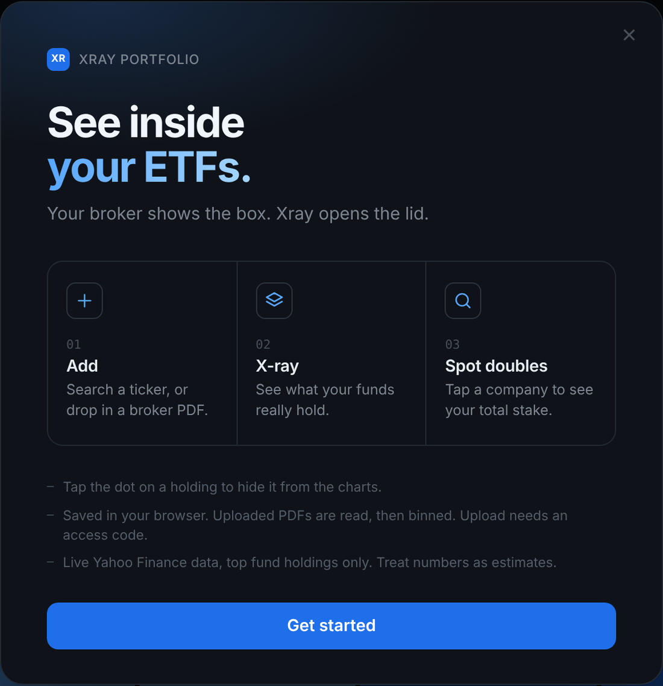
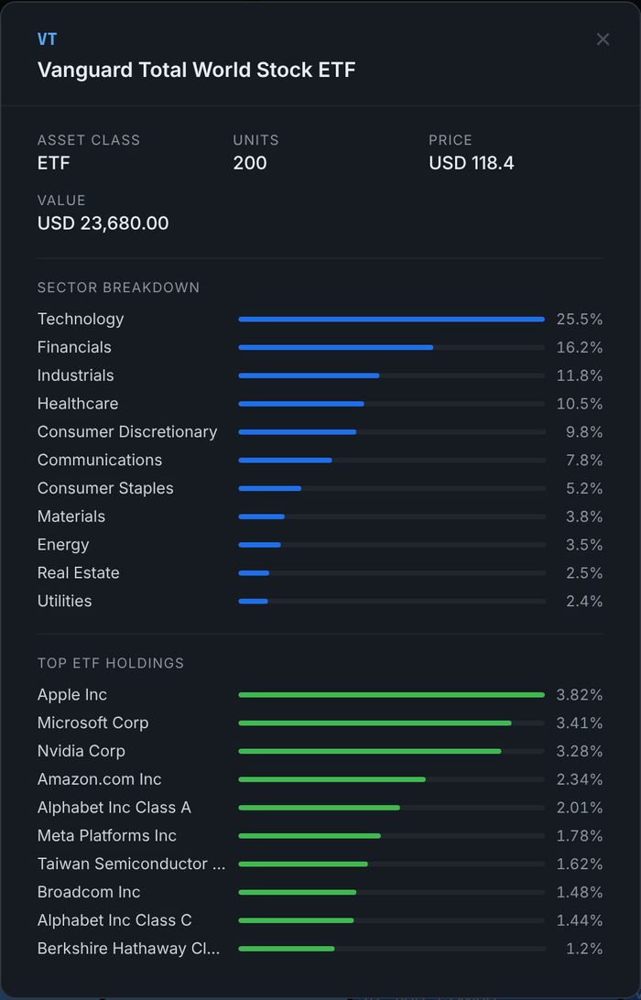
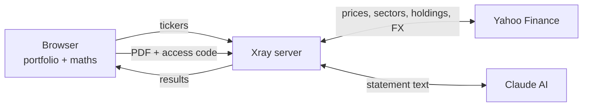

# Xray: see inside your ETFs

**Live app:** [xray-portfolio.vercel.app](https://xray-portfolio.vercel.app)


## The problem

An ETF is a basket of companies, but your broker only shows you the basket. Own a few "different" ETFs and you may be holding the same big companies several times over without knowing it.

Xray opens every fund you hold, adds your direct shares and cash, and shows what you really own.

## How to use it



1. **Add** your holdings: search a ticker and enter units, add cash, or upload a PDF broker statement (access code needed).
2. **X-ray:** the charts show your real split by asset class, sector and currency, plus a map of the companies you own most.
3. **Spot doubles:** click any company to see every way you own it, added up into one total.

<p>
  
  
</p>

No sign-up. Your portfolio is saved in your browser.

## How it's built

- **Front end** (`public/index.html`): HTML, CSS, JavaScript and Chart.js. Stores your portfolio in the browser and does all the look-through maths.
- **Server** (`src/`): Node.js and Express. Fetches market data from Yahoo Finance and handles statement uploads. Stores nothing.



**Statement upload:** the server reads the PDF's text in memory, Claude turns it into a list of holdings, the server checks every row and matches it to a live ticker, and you confirm before anything is saved.

```
public/index.html   front end
src/server.js       market-data API
src/extract/        statement upload: access code, PDF text, Claude, checks, ticker matching
test/               automated tests (npm test)
docs/               screenshots
```

## API

| Endpoint | Sends | Gets back |
|---|---|---|
| `GET /api/search?q=` | search text | up to 8 matches: symbol, name, exchange, type |
| `GET /api/price/:ticker` | one ticker | name, price, currency; ETFs also get sector weights and top 15 holdings; shares get sector and country |
| `GET /api/prices?tickers=` | up to 50 tickers | a price per ticker, any it couldn't price, timestamp |
| `GET /api/fx?currencies=` | currency codes | each currency's value in USD |
| `POST /api/extract` | PDF (max 3MB, 15 pages) + `X-Access-Code` header | statement summary (platform, account type, date, total) and one checked row per holding |
| `POST /api/extract/verify` | `X-Access-Code` header | `{ "ok": true }` or an error |

Example, `GET /api/price/VOO`:

```json
{ "ticker": "VOO", "name": "Vanguard S&P 500 ETF", "price": 512.3, "currency": "USD", "quoteType": "ETF",
  "sectorWeightings": { "Technology": 31.2 }, "topHoldings": [{ "symbol": "AAPL", "name": "Apple Inc", "pct": 7.1 }] }
```

## Security

- **Your data stays with you.** No accounts, no database. Holdings live in your browser; the market-data endpoints only see ticker symbols.
- **Uploads are locked and not kept.** Access code required (5 wrong tries = 15-minute lockout). The PDF is read in memory and discarded; only page and row counts are logged. Claude gets the text only, with no fields for account numbers or personal details.
- **Secrets stay on the server.** The Claude API key and access code live in Vercel settings, not in the code or the page.
- **Checked on the live site (20 Nov 2026):** server files (`/src/*.js`, `package.json`, `.env`, `.git`) return 404, and the page contains no keys. The front-end code is visible in any browser, as on every website, and holds nothing secret. The repo is public for the same reason; real statements never go in it.

## Run it locally

```bash
git clone https://github.com/trentacjames/xray-portfolio.git
cd xray-portfolio && npm install && npm start
```

For statement upload, set `ANTHROPIC_API_KEY` and `XRAY_UPLOAD_CODE` first. Tests: `npm test`.

## Limitations

- Looks through each ETF's top 15 holdings only, so figures are estimates.
- Some JSE ETFs use hand-entered data because Yahoo misclassifies them.
- Yahoo's data source is unofficial and can change without notice.
- Upload reads text PDFs only, one account at a time.
- Not financial advice.

## Roadmap

**Done**

- [x] Live price refresh on page load
- [x] PDF statement upload with AI extraction and checks
- [x] Heat map of top underlying holdings
- [x] Welcome panel for new visitors

**Next**

- [ ] Screenshot and scanned-statement upload
- [ ] Same ticker in more than one account
- [ ] Overlap summary: one table of the stocks you own through the most funds
- [ ] Tests for the look-through maths
- [ ] Look through more than each ETF's top 15 holdings

**Later**

- [ ] Bank and crypto statements, so you can see everything you own in one place

Built by [Trent James](https://github.com/trentacjames) with [Claude Code](https://www.anthropic.com/claude-code).
