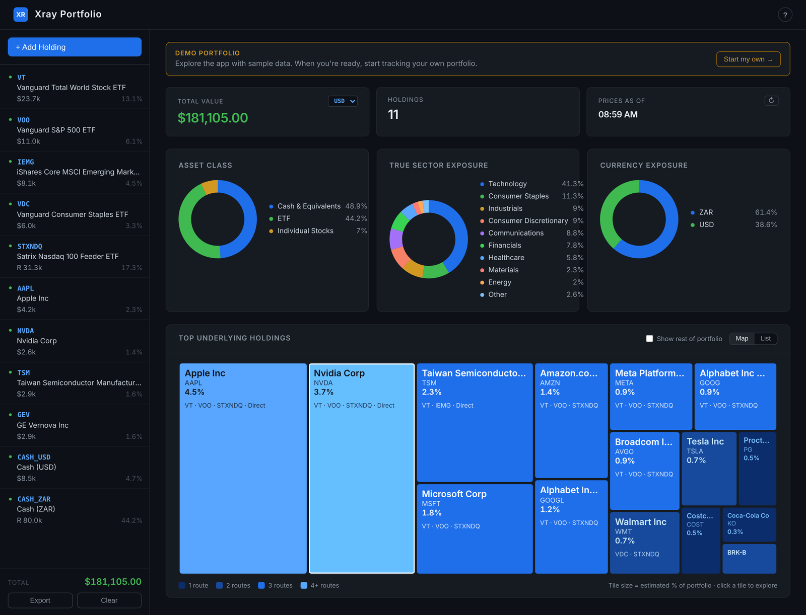
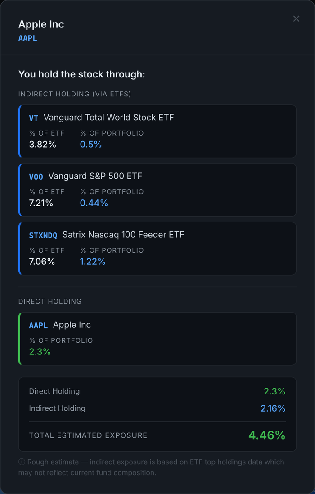
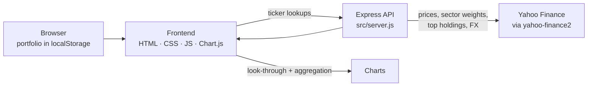

# Xray — ETF Look-Through Dashboard

**Live demo:** [xray-portfolio.vercel.app](https://xray-portfolio.vercel.app)

Xray shows what you actually own when you own ETFs. Enter a portfolio of funds and individual shares, and Xray looks through each fund to its underlying holdings. It then combines everything into one view of your real asset-class, sector and currency exposure, and shows where several "different" funds are quietly holding the same companies.



---

## Why I built it

Holding three or four ETFs feels diversified. Often it isn't: a global fund, a US fund and a tech fund can all be dominated by the same handful of mega-cap names. Fund factsheets show each ETF in isolation, so the overlap is invisible unless you add it up yourself. Xray does that sum for you.

## Features

- **Portfolio builder** — search for ETFs and individual stocks, enter units, and add cash in several currencies; your portfolio is saved in the browser (`localStorage`), so no account or login is needed
- **Statement upload (invite-only)** — upload a PDF broker statement and AI reads the holdings into a review table; every row is checked and matched to a live ticker before anything is saved, and the upload replaces that account's holdings in one step
- **Live prices** — every saved holding is re-priced in one batch call when the page loads (cached for 30 minutes, with a manual refresh button); any price Yahoo can't update is flagged as stale
- **Look-through aggregation** — weights each fund's top holdings by your position size and combines them with your direct shareholdings into one view
- **Trace any stock to its source** — click an underlying stock to see every route you own it through: which ETFs hold it, how much of each ETF it makes up, and your direct holding, summed into one total exposure
- **ETF drill-down** — click any ETF to see its sector breakdown and top holdings
- **Asset-class exposure** — how the whole portfolio splits across equities, funds and cash
- **Sector exposure** — where your capital is actually deployed, normalised to 100%
- **Currency exposure** — how your portfolio splits across the currencies you hold, with a selectable base currency and live FX rates
- **Demo portfolio** — first-time visitors see a sample portfolio with every chart populated, and can clear it to start their own
- **Mobile layout** — slide-out holdings drawer and bottom-sheet dialogs on small screens

<p>
  
  
</p>

*Left: Apple is held directly and through three ETFs, adding up to 7.83% of the portfolio. Right: the sector breakdown and top holdings of VT.*

## How it works



1. Your holdings live only in your browser. The server stores nothing about your portfolio.
2. When you add a ticker, the Express API fetches its live price from Yahoo Finance. For ETFs it also fetches sector weights and the top 15 holdings. On each visit, the dashboard draws straight away with saved prices, then re-prices every holding in one batch request (`/api/prices`) and redraws.
3. The browser scales each ETF's holdings by your position size, merges them with any shares you hold directly, and sums the result by asset class, sector and currency. It also records which ETFs each stock came from, which powers the "how do I own this?" breakdown.
4. Chart.js renders the result.

### Statement upload

```mermaid
flowchart LR
    P[PDF statement] -->|access code| X[/api/extract]
    X -->|text only, in memory| AI[Claude Haiku<br/>fixed output schema]
    AI --> V[Checks + ticker matching<br/>via Yahoo]
    V --> R[Review table in browser]
    R -->|user confirms| L[localStorage<br/>replaces that account]
```

- **Access code.** The endpoint only runs with the code stored in the `XRAY_UPLOAD_CODE` environment variable; five wrong codes lock that visitor out for 15 minutes.
- **Privacy.** The PDF's text is extracted in memory and sent to Claude; the file, text and results are never stored or logged (only page and row counts are logged). The output schema has no fields for account numbers or personal details. Statements are capped at 3MB and 15 pages; scanned PDFs without text are rejected.
- **Checks.** Units and currency must be valid; the statement's own units × price must match its value; rows must add up to the printed total (within 2%); units × today's price must be within 15% of the statement value, with a specific warning for cents vs rand mix-ups; duplicates, low-confidence rows, guessed tickers and statements older than 30 days are flagged.
- **Ticker matching.** Printed ticker first (JSE tickers get `.JO`), then ISIN search, then name search. Anything ambiguous is left for the user to pick.
- **Cost.** Claude Haiku 5.5 by default (about $0.001 per page); set `XRAY_EXTRACT_MODEL=claude-sonnet-5-5` for harder statements.

## Tech stack

| Layer       | Choice                          |
|-------------|---------------------------------|
| Backend     | Node.js, Express 5              |
| Market data | yahoo-finance2                  |
| Frontend    | Vanilla HTML/CSS/JS, Chart.js 4 |
| Persistence | Browser `localStorage`          |
| AI extraction | Claude API (`@anthropic-ai/sdk`), `unpdf` for PDF text |
| Tests       | `node:test`                     |
| Hosting     | Vercel                          |

## Project structure

```
xray-portfolio/
├── src/        # Express API (entry point: src/server.js)
│   └── extract/  # Statement upload: PDF text, Claude call, checks, ticker matching, access code
├── test/       # Unit and route tests with made-up statements (npm test)
├── public/     # Frontend: HTML, CSS, client-side JS
├── data/       # Legacy data files from the first version
├── package.json
└── README.md
```

## Running locally

Requires Node.js 18 or later.

```bash
git clone https://github.com/trentacjames/xray-portfolio.git
cd xray-portfolio
npm install
npm start
```

Then open the localhost URL printed in your terminal.

To enable statement upload locally, set two environment variables before `npm start`:

```bash
export ANTHROPIC_API_KEY=sk-ant-...
export XRAY_UPLOAD_CODE=choose-a-code
npm start
```

Run the tests with `npm test`.

## Limitations

Stated plainly, because they matter for how far the numbers can be trusted:

- **Top holdings only.** Look-through uses each ETF's top 15 holdings as reported by Yahoo Finance, so the long tail of a broad fund is not broken out stock by stock.
- **JSE ETFs need fallback data.** Yahoo misclassifies several Satrix ETFs, so Xray uses hand-entered sector and holdings data for them, which needs manual refreshing.
- **Unofficial data source.** `yahoo-finance2` uses Yahoo's unofficial endpoints, which can change or rate-limit without notice.
- **Tests cover the upload pipeline only.** The look-through and aggregation logic in the browser is not unit-tested yet.
- **Statement upload is text-only and one account at a time.** Scanned PDFs and screenshots are not supported yet. Holdings are keyed by ticker, so a ticker can only sit in one account: uploading it into a new account moves it there.
- **Not financial advice.** Xray is an analysis tool and a portfolio project.

## Roadmap

- [x] Live price refresh: re-fetch prices for all saved holdings on page load (cached ~30 min, like FX rates), so values don't stay frozen at the price when each holding was added; retire the legacy `/api/refresh` endpoint
- [x] Upload a PDF broker statement and auto-fill the portfolio (AI-assisted extraction with validation, behind an access code)
- [ ] Screenshot and scanned-statement upload
- [ ] Allow the same ticker in more than one account
- [ ] Overlap summary: a single table ranking the stocks you hold through the most routes
- [ ] Unit tests for the aggregation logic
- [ ] Broader look-through coverage beyond the top 15 holdings

## About

Built by [Trent James](https://github.com/trentacjames) as a portfolio project, developed with [Claude Code](https://www.anthropic.com/claude-code).
