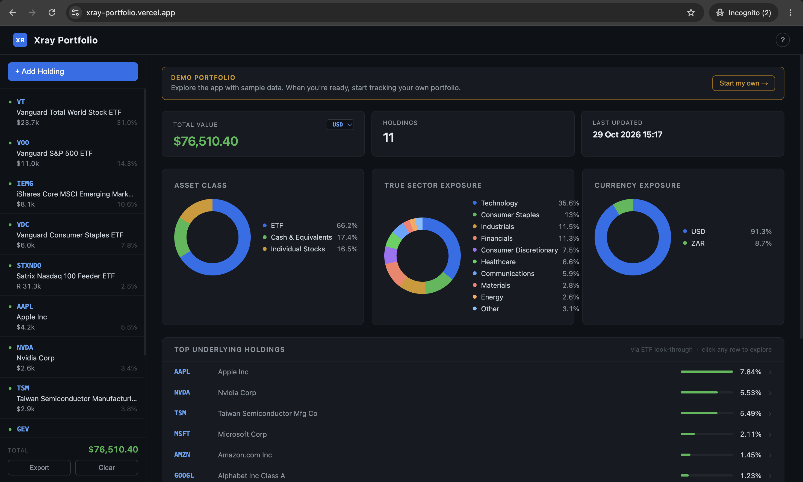
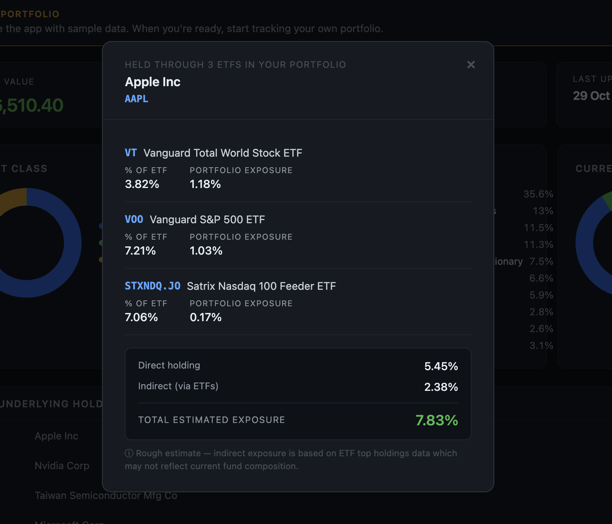
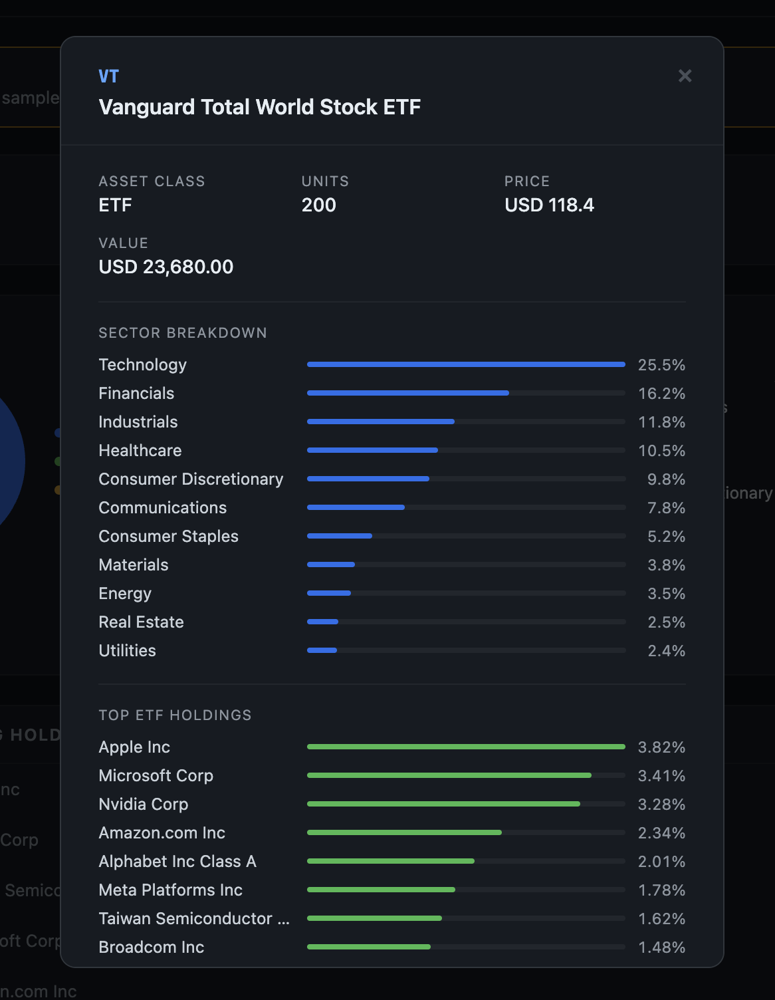
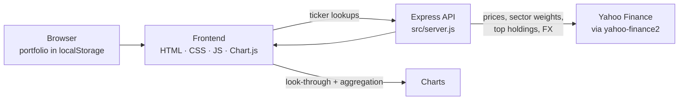

# Xray — ETF Look-Through Dashboard

**Live demo:** [xray-portfolio.vercel.app](https://xray-portfolio.vercel.app)

Xray shows what you actually own when you own ETFs. Enter a portfolio of funds and individual shares, and Xray looks through each fund to its underlying holdings. It then combines everything into one view of your real asset-class, sector and currency exposure, and shows where several "different" funds are quietly holding the same companies.



---

## Why I built it

Holding three or four ETFs feels diversified. Often it isn't: a global fund, a US fund and a tech fund can all be dominated by the same handful of mega-cap names. Fund factsheets show each ETF in isolation, so the overlap is invisible unless you add it up yourself. Xray does that sum for you.

## Features

- **Portfolio builder** — search for ETFs and individual stocks, enter units, and add cash in several currencies; your portfolio is saved in the browser (`localStorage`), so no account or login is needed
- **Look-through aggregation** — weights each fund's top holdings by your position size and combines them with your direct shareholdings into one view
- **Trace any stock to its source** — click an underlying stock to see every route you own it through: which ETFs hold it, how much of each ETF it makes up, and your direct holding, summed into one total exposure
- **ETF drill-down** — click any ETF to see its sector breakdown and top holdings
- **Asset-class exposure** — how the whole portfolio splits across equities, funds and cash
- **Sector exposure** — where your capital is actually deployed, normalised to 100%
- **Currency exposure** — how your portfolio splits across the currencies you hold, with a selectable base currency and live FX rates
- **Demo portfolio** — first-time visitors see a sample portfolio with every chart populated, and can clear it to start their own
- **Mobile layout** — slide-out holdings drawer and bottom-sheet dialogs on small screens

<p>
  
  
</p>

*Left: Apple is held directly and through three ETFs, adding up to 7.83% of the portfolio. Right: the sector breakdown and top holdings of VT.*

## How it works



1. Your holdings live only in your browser. The server stores nothing about your portfolio.
2. When you add a ticker, the Express API fetches its live price from Yahoo Finance. For ETFs it also fetches sector weights and the top 15 holdings.
3. The browser scales each ETF's holdings by your position size, merges them with any shares you hold directly, and sums the result by asset class, sector and currency. It also records which ETFs each stock came from, which powers the "how do I own this?" breakdown.
4. Chart.js renders the result.

## Tech stack

| Layer       | Choice                          |
|-------------|---------------------------------|
| Backend     | Node.js, Express 5              |
| Market data | yahoo-finance2                  |
| Frontend    | Vanilla HTML/CSS/JS, Chart.js 4 |
| Persistence | Browser `localStorage`          |
| Hosting     | Vercel                          |

## Project structure

```
xray-portfolio/
├── src/        # Express API (entry point: src/server.js)
├── public/     # Frontend: HTML, CSS, client-side JS
├── data/       # Legacy data files from the first version
├── package.json
└── README.md
```

## Running locally

Requires Node.js 18 or later.

```bash
git clone https://github.com/trentacjames/xray-portfolio.git
cd xray-portfolio
npm install
npm start
```

Then open the localhost URL printed in your terminal.

## Limitations

Stated plainly, because they matter for how far the numbers can be trusted:

- **Top holdings only.** Look-through uses each ETF's top 15 holdings as reported by Yahoo Finance, so the long tail of a broad fund is not broken out stock by stock.
- **JSE ETFs need fallback data.** Yahoo misclassifies several Satrix ETFs, so Xray uses hand-entered sector and holdings data for them, which needs manual refreshing.
- **Unofficial data source.** `yahoo-finance2` uses Yahoo's unofficial endpoints, which can change or rate-limit without notice.
- **No automated tests yet.**
- **Not financial advice.** Xray is an analysis tool and a portfolio project.

## Roadmap

- [ ] Upload a broker statement or screenshot and auto-fill the portfolio (AI-assisted extraction with validation)
- [ ] Overlap summary: a single table ranking the stocks you hold through the most routes
- [ ] Unit tests for the aggregation logic
- [ ] Broader look-through coverage beyond the top 15 holdings

## About

Built by [Trent James](https://github.com/trentacjames) as a portfolio project, developed with [Claude Code](https://www.anthropic.com/claude-code).
